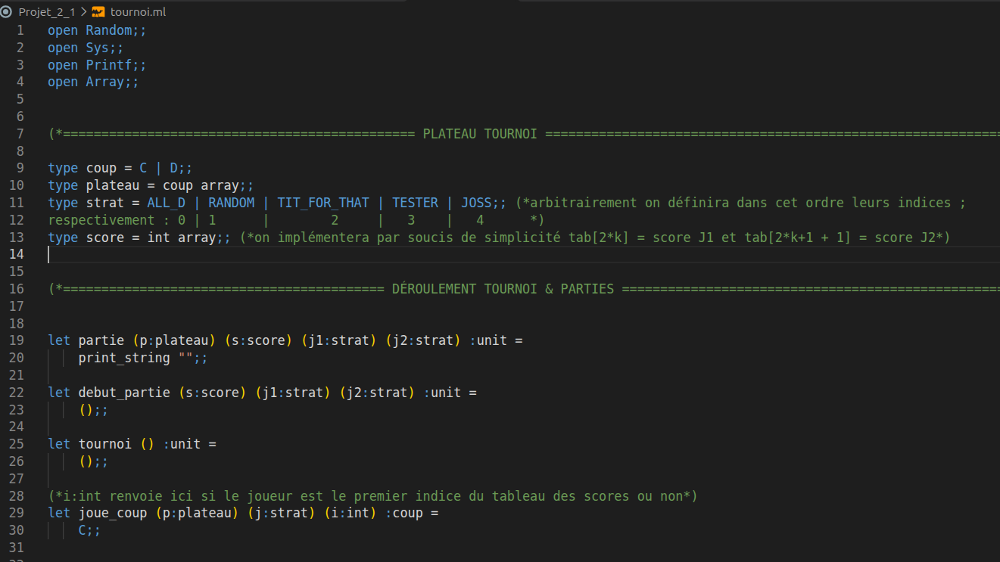
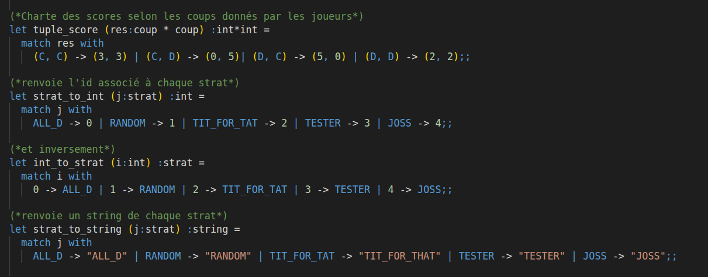
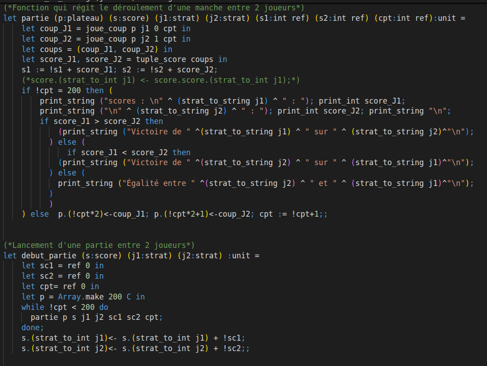
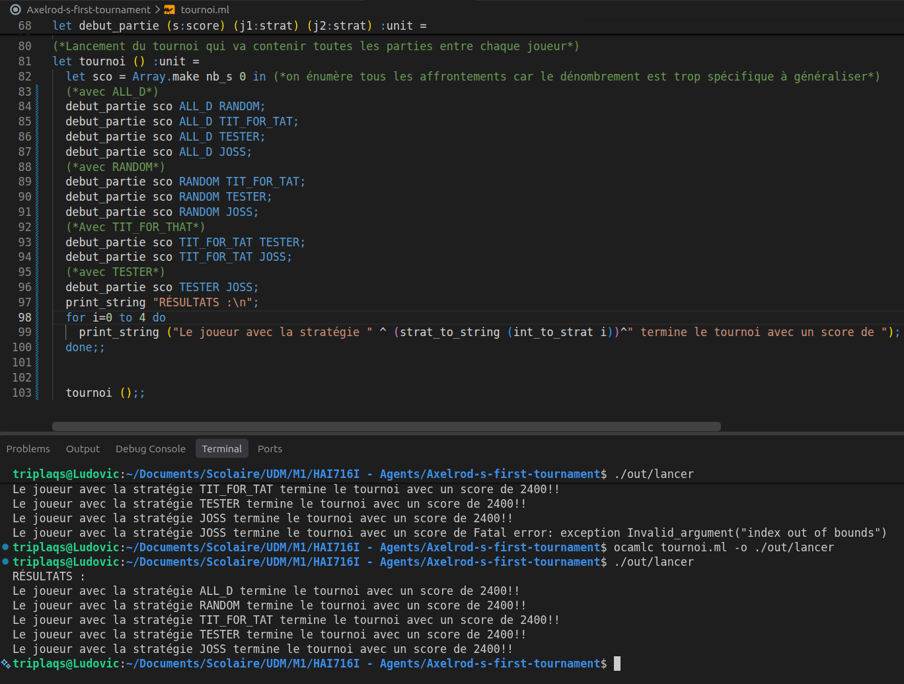

# Axelrod-s-first-tournament
Axelrod’s first tournament agent implementation in OCaml.


## Journal de bord du projet

### Départ

On choisit d’implémenter notre projet en OCaml : on esquisse nos premières structures et fonctions typées suivant notre idée de départ de direction d’implémentation ; on affinera avec les contraintes concrètes plus tard.



On créait donc notre structure d'énumération OCaml pour un pattern matching efficace, et on créait des fonctions pour qu'elles soient transverses en terme de type (string, int).



### Organisation du tournoi

On découpe le fonctionnement du tournoi en plusieurs sous-parties :

- Une fonction ```partie``` qui se chargera d'éffectuer le déroulement d'une énonciation de coups entre 2 joueurs (=stratégies).


- Une fonction ```debut_partie``` qui va préparer le terrain et les paramètres de ```partie``` en la lançant le nombre de fois nécessaires au tournoi (200 fois).


- Une fonction ```tournoi``` qui vient préparer les paramètres pour ```debut_partie``` et lancer les 10 affrontements dénombrés lors du tournoi (chaque IA affronte chaque IA sans s'affronter elle-même ; ainsi $nb_{affrontements} = \frac{5 \times 4}{2} = 10$)

- Une fonction ```joue_coup``` qui vient, avec l'information de la stratégie utilisée ainsi que l'historique des coups de la partie, calculer le coup qu'elle va jouer (et le renvoie au sein de ```partie```).

### Implémentation de chaque partie de l'organisation du tournoi

Concernant les 2 premières fonctions sur les parties ; voici l'implémentation proposée :



À ce stade, ce n'est pas difficile : on manipule et on se repose sur des fonctions et bouts de code que l'on a pas encore implémenté et que l'on fera plus tard. Par exemple mon ```joue_coup``` renvoie pour l'instant toujours C (comme on peut le constater en bas de la première image de la partie Départ") et les paramètres seront définis plus tôt.

Quant à la fonction tourno (ci-dessous) on l'a achevée et après quelques petits problèmes (```Fatal error: exception Invalid_argument("index out of bounds")```) notre tournoi renvoie ses résultats !




