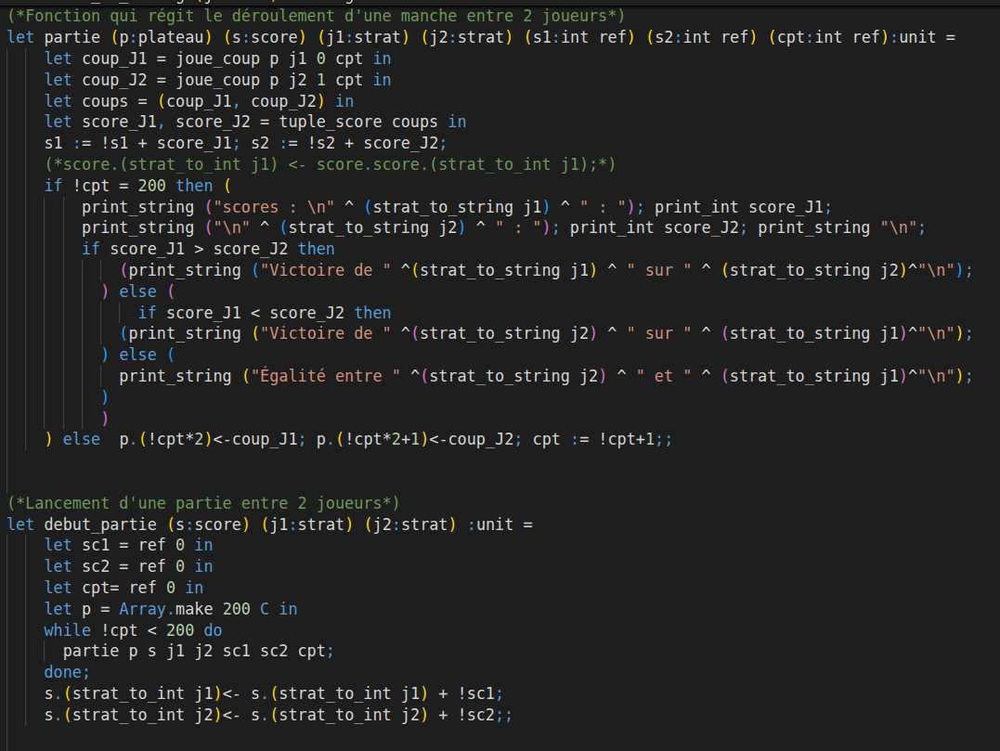
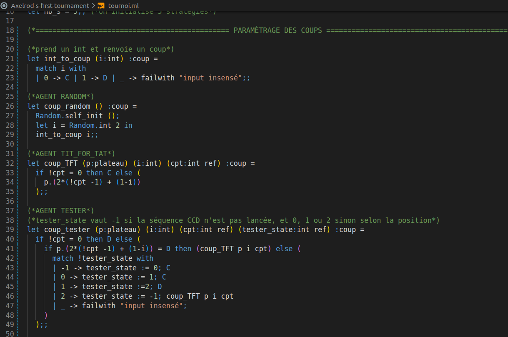
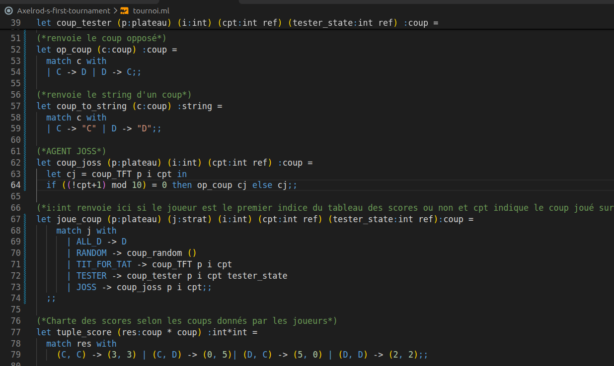
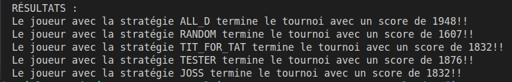
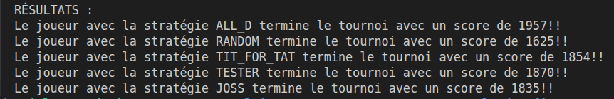
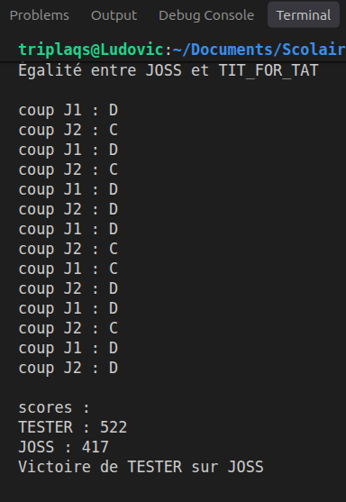

# Axelrod-s-first-tournament
Axelrod’s first tournament agent implementation in OCaml.

The code with all the tournament can be launched with ```./out/lancer```


## Journal de bord du projet

### Départ

On choisit d’implémenter notre projet en OCaml : on esquisse nos premières structures et fonctions typées suivant notre idée de départ de direction d’implémentation ; on affinera avec les contraintes concrètes plus tard.


On créait donc notre structure d'énumération **OCaml** pour un pattern matching efficace, et on créait des fonctions pour qu'elles soient transverses en terme de type (string, int).


### Organisation du tournoi

On découpe le fonctionnement du tournoi en plusieurs sous-parties :

- Une fonction ```partie``` qui se chargera d'éffectuer le déroulement d'une énonciation de coups entre 2 joueurs (=stratégies).


- Une fonction ```debut_partie``` qui va préparer le terrain et les paramètres de ```partie``` en la lançant le nombre de fois nécessaires au tournoi (200 fois).


- Une fonction ```tournoi``` qui vient préparer les paramètres pour ```debut_partie``` et lancer les 10 affrontements dénombrés lors du tournoi (chaque IA affronte chaque IA sans s'affronter elle-même ; ainsi $nb_{affrontements} = \frac{5 \times 4}{2} = 10$)

- Une fonction ```joue_coup``` qui vient, avec l'information de la stratégie utilisée ainsi que l'historique des coups de la partie, calculer le coup qu'elle va jouer (et le renvoie au sein de ```partie```).

### Implémentation de chaque partie de l'organisation du tournoi

Concernant les 2 premières fonctions sur les parties ; voici l'implémentation proposée :



À ce stade, ce n'est pas difficile : on manipule et on se repose sur des fonctions et bouts de code que l'on a pas encore implémenté et que l'on fera plus tard. Par exemple mon ```joue_coup``` renvoie pour l'instant toujours C (comme on peut le constater en bas de la première image de la partie Départ") et les paramètres seront définis plus tard.

Quant à la fonction tournoi (ci-dessous) on l'a achevée et après quelques petits problèmes (```Fatal error: exception Invalid_argument("index out of bounds")```) notre tournoi renvoie ses résultats !


Ici on constate que les scores sont tous identiques car nous n'avons toujours pas implémenté ```joue_coup``` : elle renvoie toujours C.

Implémentation des coups :





On a du rajouter la variable ```tester_state``` en paramètre dans les appels de fonciton en cascade afin de retenir l'état de la séquence CCD de la stratégie.


### Résultats, tests et cohérence

Voici 3 résultats obtenus à 3 lancers de programme différents ! Ils diffèrent à cause de la stratégie random, grossièrement le classement reste le même.








on regarde un échantillon du déroulé d'un tour d'un échange pour voir si on a une certaine cohérence globale :



Sans rentrer dans les détails des coups, j'ai voulu inspecter les 14 premiers coups dans 3 tournois représentatifs des 5 stratégies (= une stratégie apparait dans au moins l'un des 3 tournois). Et de cette manière j'ai réalisé que j'avais mal compris (et donc implémenté ```TESTER``` et ```JOSS```. Respectivement j'avais compris pour le premier qu'à chaque coup il devait regarder le coup précédent de l'autre et soit jouer comme ```TIT_FOR_THAT``` soit lancer une séquence de C,C,D et re-sonder juste après. Tandis que pour le deuxième j'avais compris qu'il devait immiter le coup précédent de son adversaire sauf une fois sur 10, dans quel cas il l'inversait (et non pas juste jouer D peu importe).

On rectifie donc ces erreurs puis on resonde les 14 premiers coups des 3 tournois qui couvrent nos 5 stratégies/joueurs :

*3 photos*

Désormais nos 5 stratégies semblent correctent, on décide de ré(analyser les résultats :

*3 photos*

Concernant les résultats, avec une étude assez grossière de la situation, on comprend pourquoi ```ALL_D``` est premier (et largement) ; en effet, si l'on joue tout le temps D, on a au pire 2 points, au plus 5 points, on a donc en moyenne 3.5 points par tour. Tandis que si l'on joue systématiquement C, on a au pire 0 et au mieux 3, donc en moyenne 1.5 points par tour. On comprend alors l'hégémonie du D et donc du ```ALL_D```.

*stats*

### Nouvelles stratégies


