# Axelrod-s-first-tournament
Axelrod’s first tournament agent implementation in OCaml.

The code with all the tournament can be compiled with ```ocamlc tournoi.ml -o ./out/lancer``` and launched with ```./out/lancer```

Then enter the numbers according to what tournament you want to run. All the information will be displayed in the terminal.

If you want to see the list of playable agents, here it is :

```
ALL_D       : 0
RANDOM      : 1 
TIT_FOR_TAT : 2
TESTER      : 3
JOSS        : 4
CHILD       : 5 
UNDECIDED   : 6
```

And here are the tournament features :

```
SINGLE MATCH     : 1
WHOLE TOURNAMENT : 2
```

And also :

```
sans modification : 0
?  : 1
?  : 2
```

## Journal de bord du projet


### Présentation

Nous avons 5 stratégies qui vont s'affronter :

```ALL_D```       : un vil joueur sans foi ni loi qui n'a aucun scrupule à trahir.

```RANDOM```      : un joueur très peu soucieux de gagner qui préfère laisser sa victoire au hasard.

```TIT_FOR_TAT``` : un joueur impliqué qui est prêt à faire des alliances en collaborant ou à se battre nuit et jour en trahissant sans cesse.

```TESTER```      : un joueur manipulateur qui va essayer de savoir les intentions de son adversaire avant d'agir, en essayant d'attiser la confiance de son adversaire pour mieux le vaincre.

```JOSS```        : un joueur qui va vouloir suivre ```TIT_FOR_TAT``` mais vouloir garder le contrôle en hésitant pas à trahir de temps en temps.

### Prévisions

d'après le tableau des scores suivant :

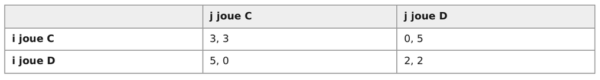

Si on joue D à un tour on a au pire 2, au mieux 5 ; donc 3.5 points de score de moyenne par tour (si dans un modèle de départ on considère qu'on a une chance sur deux que la personne en face joue C ou D).
Tandis que si on joue C, on a au mieux 3 et au pire 0, donc 1.5 points de moyenne par tour (toujours dans le même modèle).
Déjà jouer D semble très avantageux, on peut donc déceler une potentielle première place pour ```ALL_D```.

```RANDOM``` pourrait avoir la bonne succession de coups qui maximiseraient les points, cependant... avoir la bonne combinaison 4 fois 200 coups d'affilé ? cela me semble peu probable, il y a aussi le moyen de miniser les points avec une probabilité équivalente, il devrait être dans les derniers.

```TESTER``` semble avoir un fonctionnement qui marcherait si la personne en face était une personne consciente, mais si (comme présentement), les adversaires ne sont que des programmes élémentaires, la stratégie CCD me semble peu pertinente, faisant de ```TESTER``` soit au plus juste aussi bien que ```TIT_FOR_TAT```

```JOSS``` un peu pareil que  ```TESTER``` cela se jouera sûrement au joueur en face.

```TIT_FOR_TAT``` semble le plus flexible et versatile des différentes stratégies.

### Départ du projet

On choisit d’implémenter notre projet en OCaml : on esquisse nos premières structures et fonctions typées suivant notre idée de départ de direction d’implémentation ; on affinera avec les contraintes concrètes plus tard.

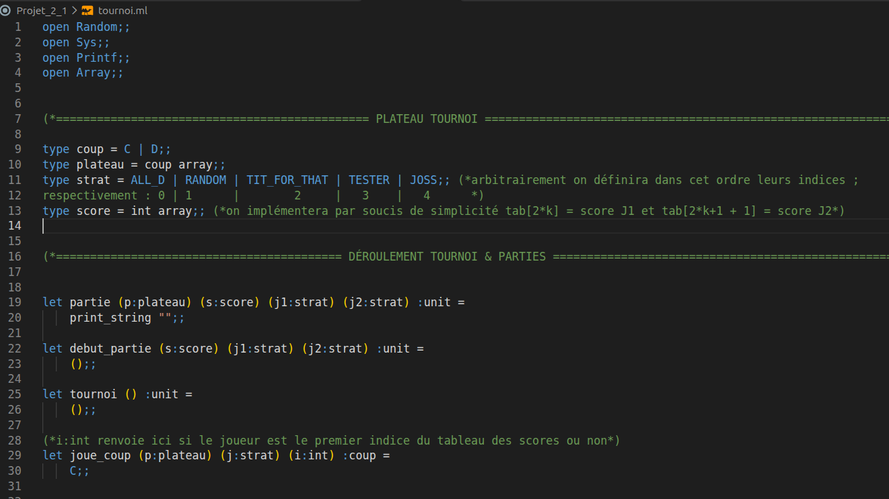

On créait donc notre structure d'énumération **OCaml** pour un pattern matching efficace, et on créait des fonctions pour qu'elles soient transverses en terme de type (string, int).

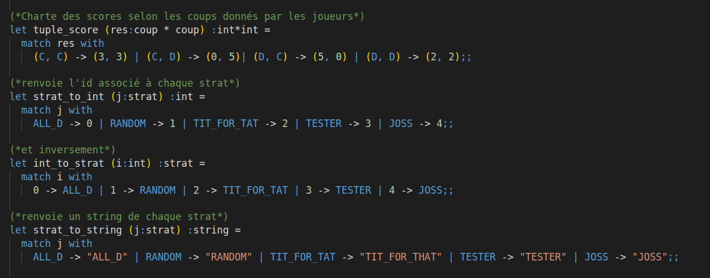

### Organisation du tournoi

On découpe le fonctionnement du tournoi en plusieurs sous-parties :

- Une fonction ```partie``` qui se chargera d'éffectuer le déroulement d'une énonciation de coups entre 2 joueurs (=stratégies).


- Une fonction ```debut_partie``` qui va préparer le terrain et les paramètres de ```partie``` en la lançant le nombre de fois nécessaires au tournoi (200 fois).


- Une fonction ```tournoi``` qui vient préparer les paramètres pour ```debut_partie``` et lancer les 10 affrontements dénombrés lors du tournoi (chaque IA affronte chaque IA sans s'affronter elle-même ; ainsi $nb_{affrontements} = \frac{5 \times 4}{2} = 10$)

- Une fonction ```joue_coup``` qui vient, avec l'information de la stratégie utilisée ainsi que l'historique des coups de la partie, calculer le coup qu'elle va jouer (et le renvoie au sein de ```partie```).

### Implémentation de chaque partie de l'organisation du tournoi

Concernant les 2 premières fonctions sur les parties ; voici l'implémentation proposée :


À ce stade, ce n'est pas difficile : on manipule et on se repose sur des fonctions et bouts de code que l'on a pas encore implémenté et que l'on fera plus tard. Par exemple mon ```joue_coup``` renvoie pour l'instant toujours C (comme on peut le constater en bas de la première image de la partie Départ") et les paramètres seront définis plus tard.

Quant à la fonction tournoi (ci-dessous) on l'a achevée et après quelques petits problèmes (```Fatal error: exception Invalid_argument("index out of bounds")```) notre tournoi renvoie ses résultats !

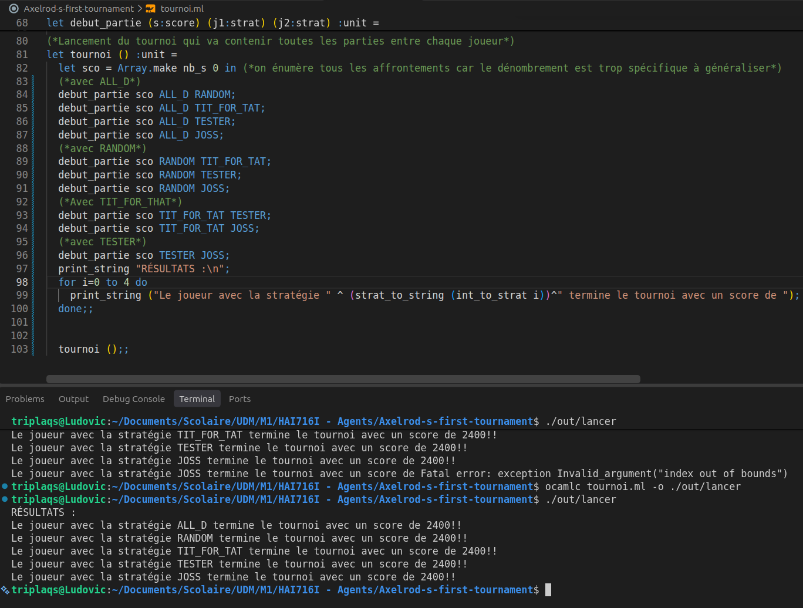

Ici on constate que les scores sont tous identiques car nous n'avons toujours pas implémenté ```joue_coup``` : elle renvoie toujours C.

Implémentation des coups :


On a du rajouter la variable ```tester_state``` en paramètre dans les appels de fonciton en cascade afin de retenir l'état de la séquence CCD de la stratégie.


### Résultats & tests 

Voici 3 résultats obtenus à 3 lancers de programme différents ! Ils diffèrent à cause de la stratégie random, grossièrement le classement reste le même.


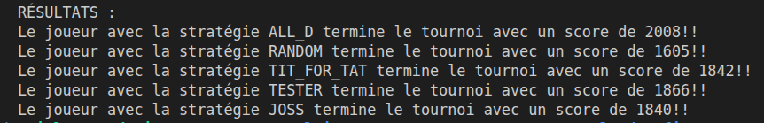

on regarde un échantillon du déroulé d'un tour d'un échange pour voir si on a une certaine cohérence globale :


Sans rentrer dans les détails des coups, j'ai voulu inspecter les 14 premiers coups dans 4 tournois représentatifs des 5 stratégies (= une stratégie apparait dans au moins l'un des 4 tournois). Et de cette manière j'ai réalisé que j'avais mal compris (et donc implémenté ```TESTER``` et ```JOSS```. Respectivement j'avais compris pour le premier qu'à chaque coup il devait regarder le coup précédent de l'autre et soit jouer comme ```TIT_FOR_THAT``` soit lancer une séquence de C,C,D et re-sonder juste après. Tandis que pour le deuxième j'avais compris qu'il devait immiter le coup précédent de son adversaire sauf une fois sur 10, dans quel cas il l'inversait (et non pas juste jouer D peu importe).

On rectifie donc ces erreurs puis on resonde les 14 premiers coups des 4 tournois qui couvrent nos 5 stratégies/joueurs :


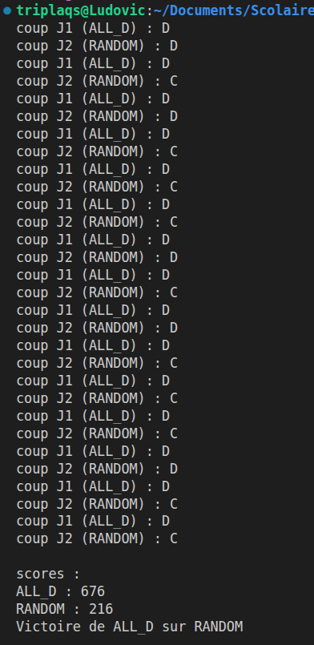

On montre ici la fonctionnalité de ```ALL_D``` (assez facile) et celle ```RANDOM``` qui varie qu'importe les coups d'en face.


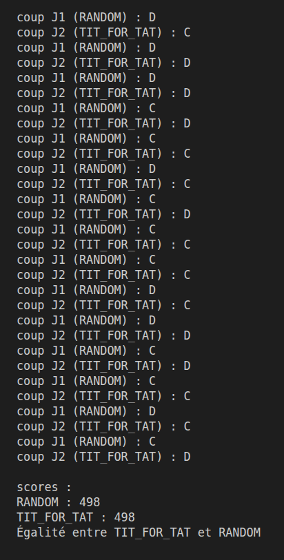


Grâce à notre ```RANDOM``` montré fonctionnel précédemment, on montre ici notre ```TIT_FOR_THAT``` fonctionnel : il se calque sur le ```RANDOM```.


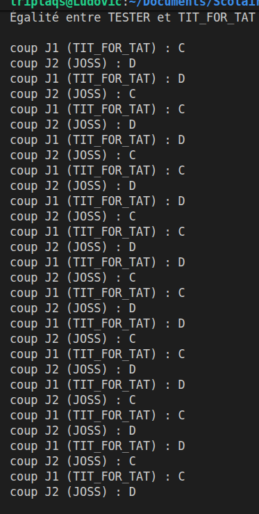

Et ici ```TESTER``` fonctionne en croyant à la crédulité du premier C de ```TIT_FOR_THAT``` il essaye de l'appater en faisant deux C puis un D continuellement. (L'autre phase de ```TESTER``` fait juste appel à une fonction qu'on a déjà vu fonctionnelle plus haut, on s'épargne l'encombrement d'une 5ème capture d'écrant).

Ici on montre la fonctionnalité de ```JOSS``` avec en face ```TIT_FOR_THAT``` ; on voit que les 2 commencent avec leurs coups respectifs (différents) et qu'ils vont passer la partie à changer de coup en copiant celui d'en face au tour précédent, ils ont donc une égalité parfaite (j'ai oublié de capturer les scores sur celle-ci).


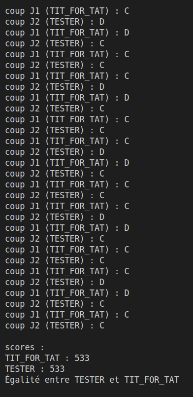


Désormais nos 5 stratégies semblent correctent, on décide de ré(analyser les résultats :


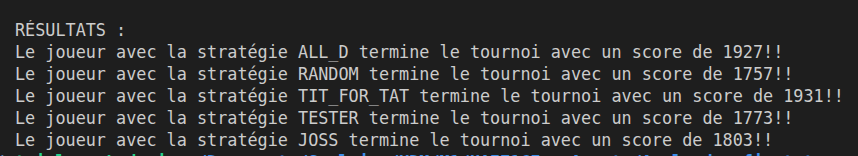


On a donc majoritairement :

```
1er  : TIT_FOR_TAT
2ème : ALL_D
3ème : JOSS
4ème : TESTER
5ème : RANDOM
```

### Analyse et cohérence

Concernant les résultats, avec l'étude assez grossière de la situation faites dans la rubrique ```Prévisions```, on comprend pourquoi ```ALL_D``` est si bien placé ; en effet, comme dit précedemment : si l'on joue tout le temps D, on a au pire 2 points, au plus 5 points, on a donc en moyenne 3.5 points par tour. Tandis que si l'on joue systématiquement C, on a au pire 0 et au mieux 3, donc en moyenne 1.5 points par tour. On comprend alors l'hégémonie du D et donc du ```ALL_D```.

Dans les faits, si ```ALL_D``` joue avec lui même (ce qu'on a pas implémenté ici), il ferait $200 \times 2 = 400$ points lors de l'échange, et si (il existait) la stratégie ```ALL_C``` qui joue uniquement C, et que cette dernière jouait avec elle même, elle aurait $200 \times 3 = 6OO$ points lors de l'échange, soit 1.5 fois le score de ```ALL_D``` dans son tournoi contre lui même. Sauf que dans notre tournoi à nous, toutes les stratégies affrontent toutes les autres. Donc ```ALL_D``` devrait affronter ```ALL_C``` et là on aurait 1000 points pour ```ALL_D``` et 0 pour ```ALL_C``` transformant l'issu du tournoi de 400 à 600 en 1400 à toujours 600.

Malheureusement les règles du jeu vont favoriser la trahison quand celui en face essayent de coopérer. 

Néanmoins dans le contexte présent, on n'a en effet pas 50% de chance que le joueur en face joue D, c'est un modèle qui atteint ses limites dans les faits, comme on l'a vu, on a plus intérêt de jouer D, c'est donc majoritairement des D face auxquels on risque de se fritter si on joue. En reprenant la reflexion de tout à l'heure : si on joue D on a soit 2 soit 5, et si on joue C on a entre 0 et 3. Alors si on développe un modèle plus hybride qui arrive à avoir les 5 points du D quand l'adversaire baisse sa garde, mais aussi jouer C pour qu'il puisse justement plus facilement la baisser. donc accepter d'avoir des 3 points pour essayer d'avoir plus tard des 5 à la place des 2.

Notre première position est donc, à l'instar du tournoi d'Axelrod de 1980 : ```TIT_FOR_TAT```

### Nouvelles stratégies : présentations et prévisions

Les 2 nouvelles stratégies proposées dans ce projet sont les suivantes :

```CHILD``` : enfant irréfléchi et insoucieux, va choisir son premier coup sans se soucier de sa pertinence et fera l'inverse de son adversaire tout le reste de la partie par esprit de contradiction.

L'agent  ```CHILD``` va générer un premier coup au hasard comme ```RANDOM``` (on fera d'ailleurs appel à sa fonction), puis jouera l'inverse du coup précédent de son adversaire.

```UNDECIDED``` : Un joueur indécis, qui change de stratégie intempestivement tout au long de la partie.

L'agent ```UNDECIDED``` qui va générer un nombre de coup (entre 1 et 20) au hasard et une stratégie parmis les précédentes (dont ```CHILD```) en l'appliquant pendant le nombre de coups obtenus juste avant. On crééra une variable pour tenir le compte de suivi des coups.

Concernant les prévisions, l'agent ```CHILD``` me semble être une bonne porposition, sans compter le premier coup aléatoire (qui est néglogeable sur 200 coups) il va appliquer ```TIT_FOR_TAT``` en inversant la réponse, ce qui pourrait contre-intuitivement peut être permettre d'anticiper des changements de décision de l'adversaire.

Quant à ```UNDECIDED``` c'est une proposition chaotique sans grande prétention, qui arrivera sans doute à se hisser malgré tout devant ```RANDOM``` car il y a des portions de sens dans ses coups. Voir même au dessus des stratégies les moins bonnes.

On en profite pour dévélopper une interface utilisateur dans le terminal, voici le code :


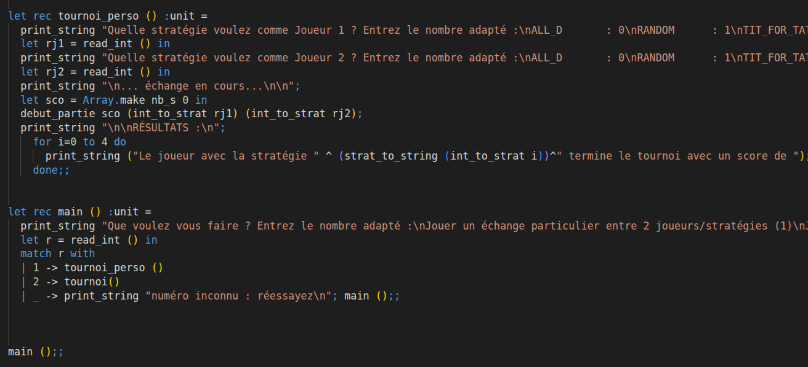

Elle nous permet de selectionner un seul échange entre deux stratégies, on choisit d'essayer nos deux nouvelles :

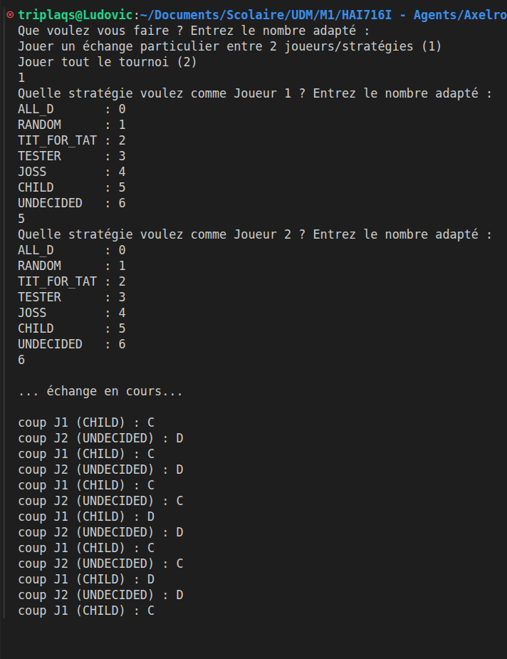
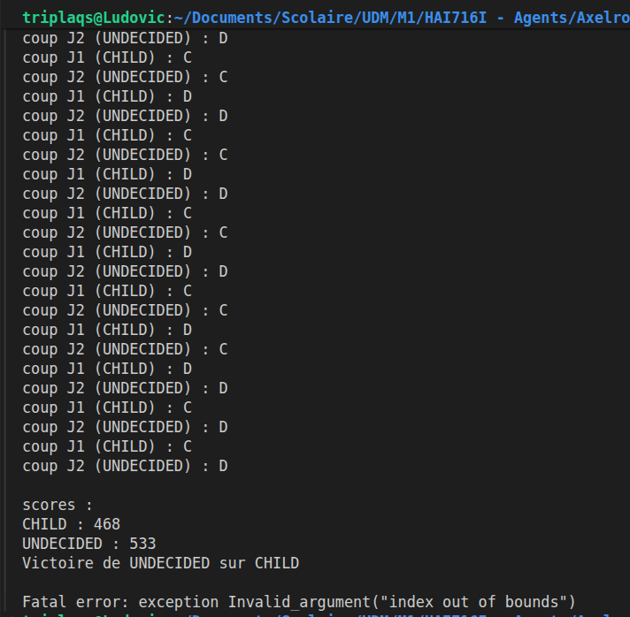

Cet échange créait une erreur : ```Fatal error: exception Invalid_argument("index out of bounds")``` : on utilise le débuggueur OCaml pour identifier cette erreur (```ocamldebug ./out/lancer```).
On essaye avec les autres stratégies et on isole que le problème vient des nouvelles stratégies (en les essayant avec elles-mêmes, les 2 posent problème).

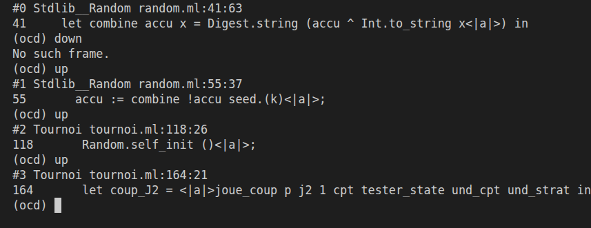

On isole grâce au debogage la ligne qui pose problème.

Le problème (très bête) a été retrouvé, nous n'avions pas modifié cette variable globale :

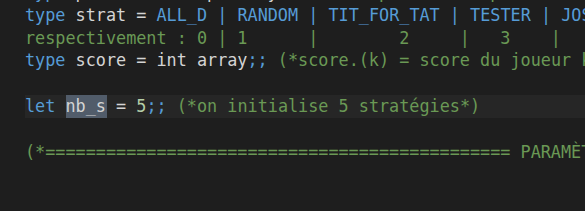

Le problème était toujours là, en cherchant mieux le vrai problème était cette ambiguieté entre une variable locale i de pattern matching réinjectée dans la fonction appelée à la place du paramètre i qui aurait du y être (censé être 0 et 1) avec le i local qui va jusqu'à 20.


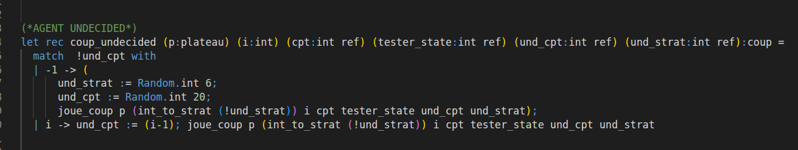

On a enfin un programme et 2 nouveaux agents qui fonctionnent :

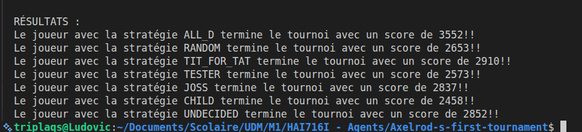


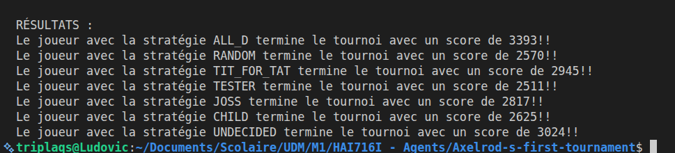


Cette fois-ci notre classement global est le suivant :

```
1er  : ALL_D
2ème : TIT_FOR_TAT
3ème : UNDECIDED
4ème : JOSS
5ème : RANDOM
6ème : TESTER
7ème : CHILD
```

Mes prédictions sur le comportement de l'addition de ```CHILD``` et ```UNDECIDED``` étaient érronnées... Il se trouve que la chance leur a été plus favorable que prévue. Une étude bien plus longue et chronophage sur les comportements 2 à 2 entres stratégies pourraient être menée, mais on préférera entammer l'étape 4 : les bonus de tournoi.

### Nouvelles règles : présentations et prévisions

On choisit d'implémenter ```Bruit``` et ```Horizon Inconnu```.

On ajoute donc deux variables (booléennes ou entières à voir selon les contraintes d'implémentations) qui vont servir pour savoir les quelles sont appliquées ou non et comment.

On intercale une fonction interface utilisateur terminale entre le main et le lancer de tournoi pour le choix des features qui va placer les réponses dans des variables globales.


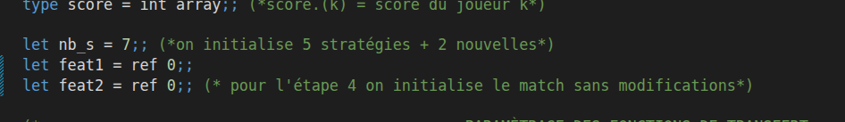


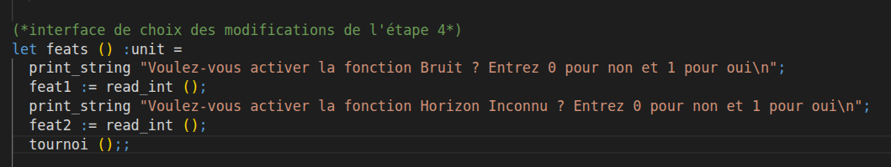

On a implémenté ```Bruit``` : 

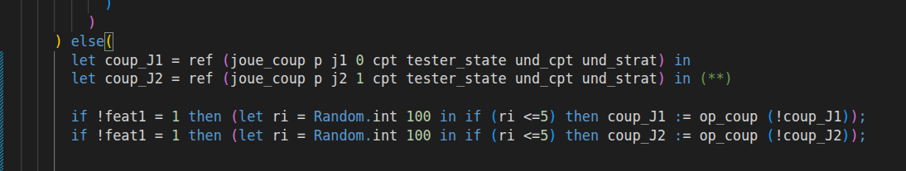

Il nous reste ```Horizon Nouveau``` qu'on aurait implémenté de la même manière mais par manque de temps nous n'avons pu.

Sinon en continuiant le projet en dehors du temps imparti, voici les résultats d'un tournoi avec les 7 stratégies et la fonction ```Bruit``` :


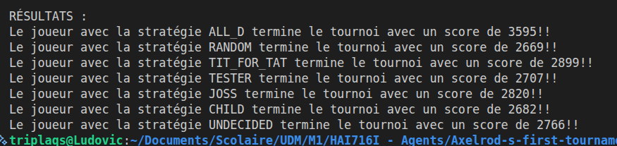


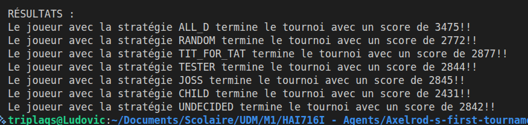


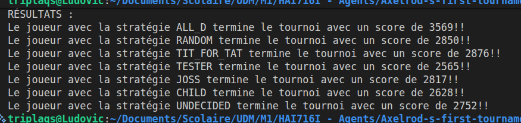

On code ```Horizon Nouveau``` :


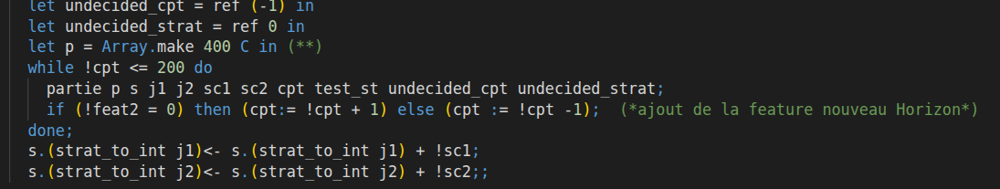

On prend le compteur de tours en hotage et on le fait aller dans les négatifs, pour qu'ils n'activent pas la condition du while et qu'on puisse malgré tout compter combien de tours on fait.


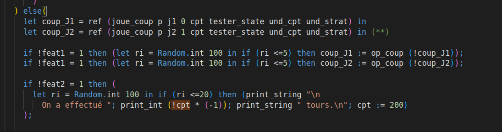

On fait similairement à ```Bruit``` une selection probabiliste en proportion sur 100 afin d'arrêter la boucle.

Cela requiert malheureusement de transformer ```cpt``` en sa valeur absolue lors de tous les appels d'indice en tableau, mais c'est pas grave  nous le ferons.


